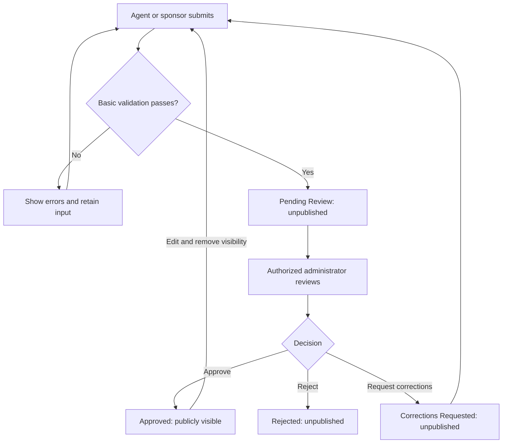

# Proposed content approval workflow
Purpose: define a candidate publication process for listings and sponsor advertisements. Reviewer authority and content policy are unconfirmed.

1. Agent or sponsor submits content.
2. System performs basic required-field and format validation.
3. Valid content enters **Pending Review** and remains unpublished.
4. Authorized administrator reviews accuracy, completeness, and permitted claims.
5. Administrator approves, rejects, or requests corrections.
6. Approved content becomes publicly visible.
7. Rejected content remains unpublished; corrections return through validation and review.

## Content rules and state model
Property listings: proposed required address, price, and description; actual fields and allowed public address detail require confirmation. Sponsor advertisements: proposed business display name, promotional text, and contact method; claims and asset permissions require confirmation. These fields are test assumptions, not verified policy.

Draft → Pending Review → Approved, Rejected, or Corrections Requested.
Corrected or edited submissions return to Pending Review after validation. Provisional rule: editing approved content removes public visibility until reapproval; confirm whether preserving a prior approved version is preferable.

Only authorized reviewers may change review decisions. Public browse, search, and direct detail access must exclude every non-approved state. Reviewer identity, decision time, and reason should be recorded; retention rules remain unresolved. Content review does not prove advertising claims are true.

## Failure conditions
- Missing or malformed fields: retain input, show specific messages, do not enter review.
- Unauthorized approval: deny action and preserve existing state.
- Save or publication failure: retain unpublished state; report failure without claiming success.
- Conflicting edits: reject stale decision and reload current content.
- Unsupported sponsor claim: request supporting information or reject according to an agreed policy.
- Corrections requested: remain unpublished, explain needed changes, and revalidate on resubmission.

## Questions for confirmation
Who is the reviewer and backup? What substantiation is required for claims? What turnaround is feasible? Who may withdraw content? What edit and retention policy is acceptable? How are disputes handled?

