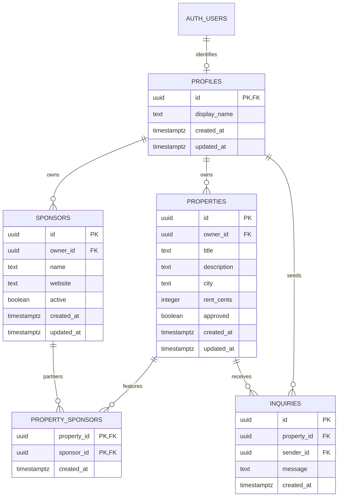

# Entity relationship and defensive schema review

## DDL inspection

This is an AI-authored inspection; student manual review remains required.

| Concern | Decision and verification |
|---|---|
| Primary keys | UUID IDs; profile ID is the Auth user ID; composite partnership key prevents duplicate pairs |
| Foreign keys | Every ownership/link/sender reference is enforced; foreign-key indexes support dependent lookups |
| Nullability | All business fields and timestamps required; no nullable owner or approval state |
| Checks | Trimmed nonempty bounded strings; nonnegative bounded integer cents; bounded HTTPS sponsor URL |
| Timestamps | UTC-aware `timestamptz`; server defaults; invoker trigger refreshes `updated_at`; clients lack timestamp write grants |
| Cascades | Auth → profile cascades only if other references permit; profile → property/sponsor/inquiry restricts deletion; property/sponsor → join rows cascades; property → inquiry restricts deletion |
| RLS | Enabled and forced on all five tables; grants are explicit; no default allow policies; tests assert actual visibility and affected rows |
| Ownership | Inserts check authenticated UUID; UPDATE column grants exclude owner IDs; USING and WITH CHECK restrict unapproved/inactive records |
| Publication | Clients cannot insert/update approval or activation; administrators use a separately authorized server route |
| Private data | Profiles and inquiries restricted to self; public listing routes return only explicit display columns |

## Defensive critique and choices

- RLS alone does not make mutable approval safe: prevent both self-approval and ownership transfer with column grants as well as policies. Tests attempt both directly in SQL.
- A user's `user_metadata` is not trusted for administrator status. Only verified `getUser` output with server-controlled `app_metadata.role` authorizes the service-role route. Never grant users a way to change that metadata. Profile rows contain no administrator flag.
- Never use the service role for ordinary owner writes. Those calls carry the user's bearer token and remain constrained by RLS. Service credentials intentionally bypass RLS; denial tests should not expect service-role denial on ordinary table access.
- Join-table visibility checks both publication states explicitly, even for owners who can otherwise read drafts. Clients cannot create partnerships without trusted review.
- Broad table SELECT grants mean anyone who directly uses the Data API can see ownership UUIDs and timestamps on public properties/active sponsors. Those IDs are treated as public identifiers, not secrets; profiles and inquiries remain private. Add column-limited views/grants in a future migration if ownership IDs become sensitive.
- Inquiries currently require authentication and are readable only by the sender; owners cannot read visitor messages through the client. A future staff workflow needs separately authorized routes and explicit privacy rules.
- Restrictive inquiry FKs preserve messages when someone attempts listing/account deletion. No client has DELETE permission. Retention and account deletion require a deliberate future policy/migration.
- The HTTPS URL check is a format constraint, not a trust check. Sponsor URLs are not fetched or rendered by this UI. Any future outbound fetch needs its own URL/network validation.
- Database-only CHECK lengths count PostgreSQL characters; server validation may reject some Unicode strings sooner. Both boundaries enforce maximum sizes and nonempty values.
- PostgreSQL fixtures have no passwords. They demonstrate constraints/RLS, not sign-in. Use separately created development Auth accounts for the hosted HTTP exercise.

References consulted: [Supabase RLS](https://supabase.com/docs/guides/database/postgres/row-level-security), [securing data](https://supabase.com/docs/guides/database/secure-data), and [getUser verification](https://supabase.com/docs/reference/javascript/auth-getuser). Supabase documents that service/secret keys bypass RLS and must remain off the client.
